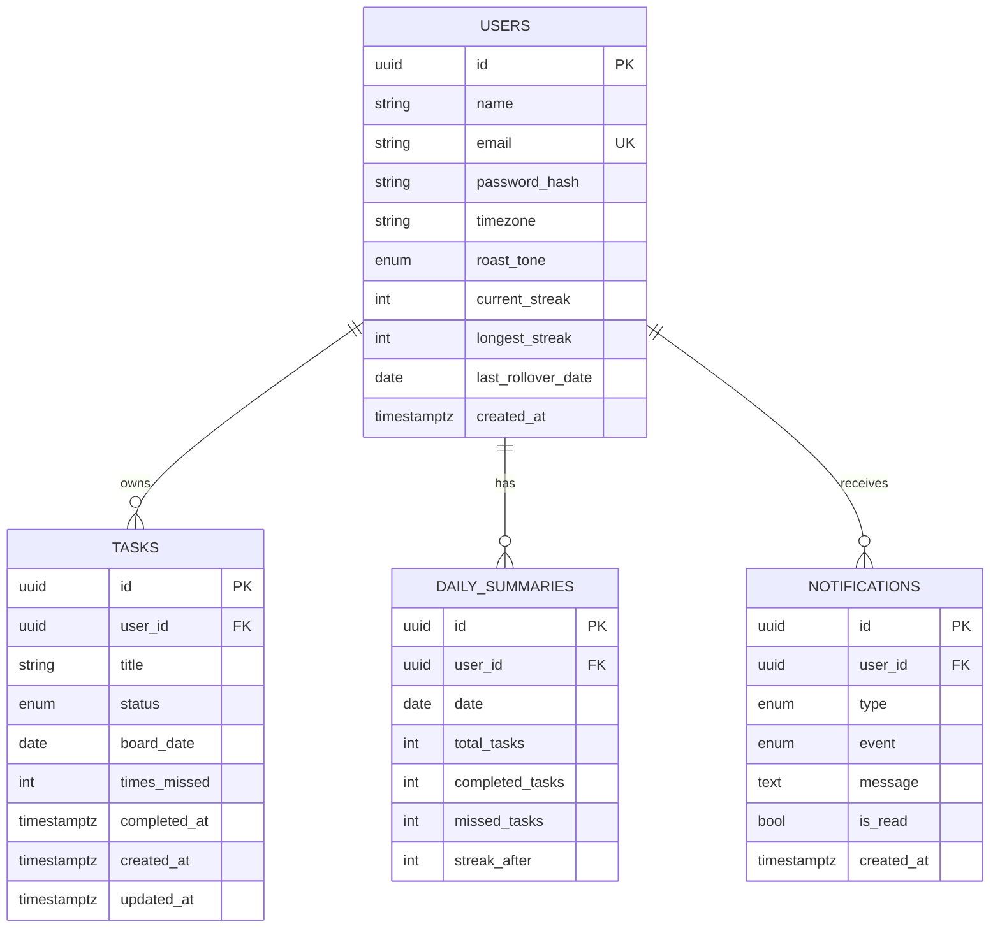

# Data model

Database: PostgreSQL. Timestamps are stored in UTC (`timestamptz`). "Days" are stored as `date` values in the user's local time zone.

## Tables

### users
| Column | Type | Notes |
|---|---|---|
| id | UUID, PK | |
| name | varchar(100) | |
| email | varchar(255), **unique** | Used to log in |
| password_hash | varchar(255) | bcrypt hash. Never store the plain password |
| timezone | varchar(64) | IANA name, e.g. `Asia/Kolkata`. Defines "midnight" |
| roast_tone | enum | `sarcastic`, `loving`, `angry` |
| current_streak | integer, default 0 | |
| longest_streak | integer, default 0 | |
| last_rollover_date | date, nullable | Last day already processed by the rollover |
| created_at | timestamptz | |

### tasks
| Column | Type | Notes |
|---|---|---|
| id | UUID, PK | |
| user_id | UUID, FK -> users.id | Owner. `ON DELETE CASCADE` |
| title | varchar(255) | |
| status | enum | `pending`, `done`, `waitlisted` |
| board_date | date, nullable | The day's board it belongs to. `NULL` while waitlisted |
| times_missed | integer, default 0 | How many midnights this task has missed. Drives the "late complete" roast |
| completed_at | timestamptz, nullable | Set when done |
| created_at | timestamptz | |
| updated_at | timestamptz | |

### daily_summaries
One row per user per processed day. Powers history, stats and makes the rollover safe to repeat.

| Column | Type | Notes |
|---|---|---|
| id | UUID, PK | |
| user_id | UUID, FK -> users.id | |
| date | date | The day summarized |
| total_tasks | integer | |
| completed_tasks | integer | |
| missed_tasks | integer | |
| streak_after | integer | Streak value after this day |

### notifications
| Column | Type | Notes |
|---|---|---|
| id | UUID, PK | |
| user_id | UUID, FK -> users.id | |
| type | enum | `roast`, `reminder` |
| event | enum | `task_added`, `task_completed`, `late_completed`, `day_missed`, `reminder` |
| message | text | The final roast text shown to the user |
| is_read | boolean, default false | |
| created_at | timestamptz | |

## Relationships
- One user has many tasks (`tasks.user_id`).
- One user has many daily summaries.
- One user has many notifications.
- A waitlisted task is a task row with `status = 'waitlisted'` and `board_date = NULL`. It is not a separate table.

## Constraints
- `users.email` unique.
- `daily_summaries(user_id, date)` unique, so a day can only be processed once.
- **Max 5 tasks per board** (`user_id` + `board_date`) cannot be expressed as a simple column constraint. It is enforced in the service layer inside a transaction, and covered by tests. See decision D9.

## Indexes
| Index | Why |
|---|---|
| `tasks(user_id, board_date)` | Fetch today's board and past days |
| `tasks(user_id, status)` | Fetch the waitlist |
| `notifications(user_id, is_read, created_at)` | Unread notifications, newest first |
| `daily_summaries(user_id, date)` (unique) | History lookups and rollover idempotency |
| `users(email)` (unique) | Login lookup |

## Diagram
