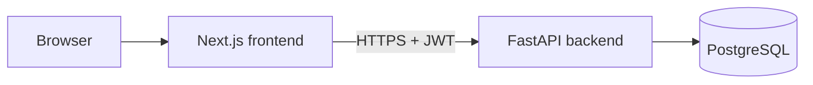
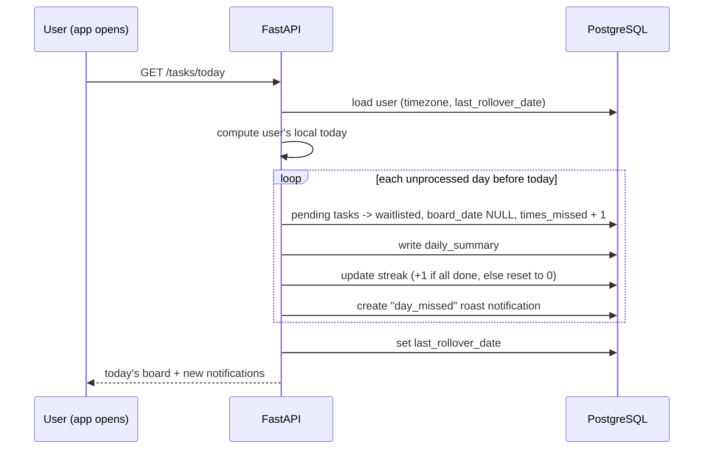

# Architecture

## System overview

Roasts are template-based in v1, so there are no external services. An LLM API can be added later behind the same roast service.

## Backend layers
```
backend/app/
├── main.py        # app creation, middleware (CORS), router registration
├── core/          # config, security (password hashing, JWT)
├── db/            # engine, session, base
├── models/        # SQLAlchemy tables
├── schemas/       # Pydantic request/response models
├── routers/       # HTTP only: auth.py, tasks.py, notifications.py, stats.py
├── services/      # business rules: task_service, rollover_service, roast_service, streak_service
└── deps.py        # get_db, get_current_user, run_rollover
```
**Rule:** routers handle HTTP and call services. Services hold the business rules and talk to the DB. Routers never contain business logic.

## Request flow (example: complete a task)
1. Browser sends `POST /api/v1/tasks/{id}/complete` with the JWT.
2. Middleware (CORS) runs.
3. The router matches the path.
4. Dependencies run: open a DB session, decode the JWT into the current user, run the rollover for that user.
5. The route function calls `task_service.complete_task`.
6. The service checks the task belongs to the user and is `pending`, marks it done, updates the streak if the board is now fully done, and asks `roast_service` for a message (`late_completed` if `times_missed > 0`, otherwise `task_completed`).
7. The service saves the notification and commits the transaction.
8. Pydantic shapes the response, and the client gets the task plus the roast.

## Midnight rollover (lazy)
There is no background job in v1. The rollover runs whenever a logged-in user makes a task or stats request.


Because `daily_summaries(user_id, date)` is unique and `last_rollover_date` is tracked, running the rollover twice cannot double-process a day.

## Enforcing the 5-task limit
Adding and moving tasks happen inside a transaction that locks the user's row, counts tasks on the target board, and only then inserts. This prevents two simultaneous requests from creating a sixth task.

## Security
- Passwords are hashed with bcrypt.
- JWTs are signed with a secret from the environment.
- Every task query filters by the current user's id.
- Secrets live in `.env` (git-ignored). `.env.example` documents the variables.

## Deployment (planned)
- Frontend on Vercel, with `frontend/` as the root directory.
- Backend and PostgreSQL on Render or Railway, with `backend/` as the root directory (Docker).
- Migrations are applied on deploy with `alembic upgrade head`.

## Later (v2 ideas)
- A scheduled job for rollover and email reminders
- LLM-personalized roasts with a template fallback
- Web push notifications